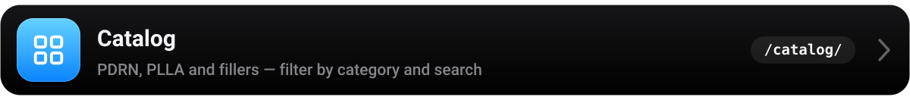
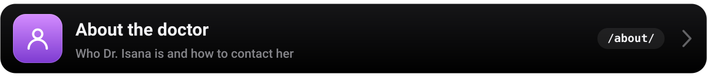
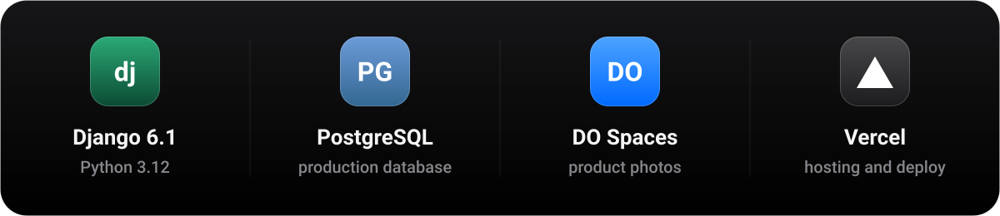
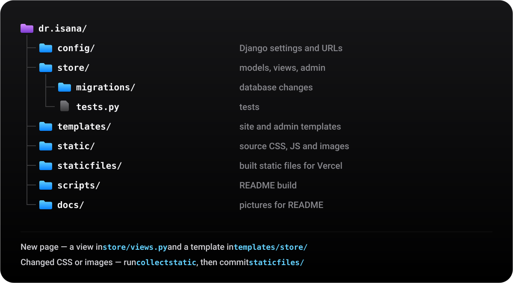
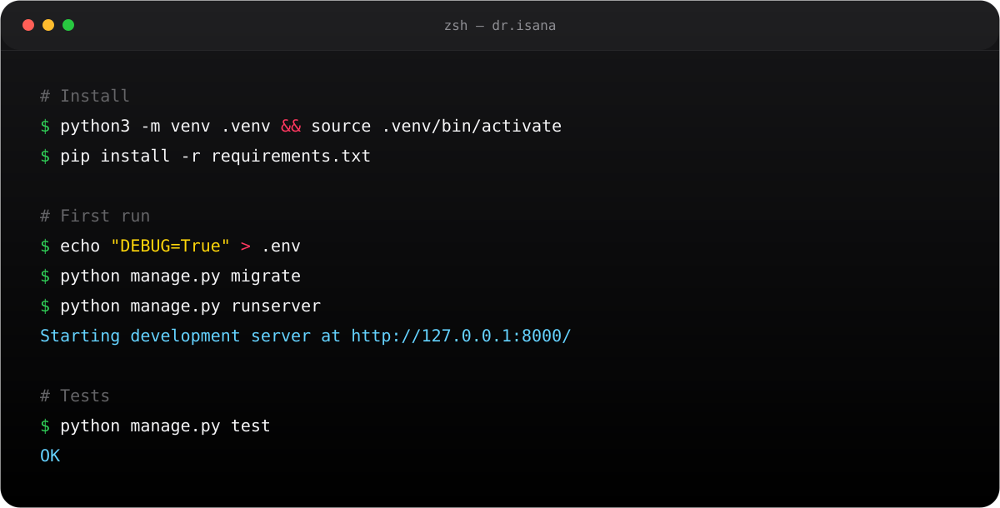
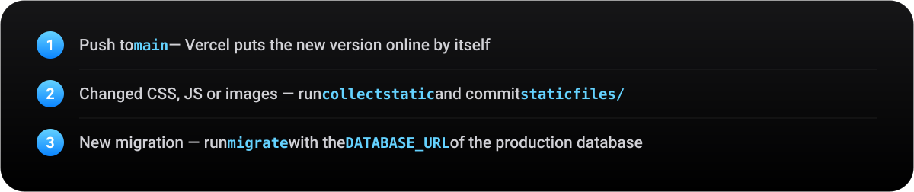
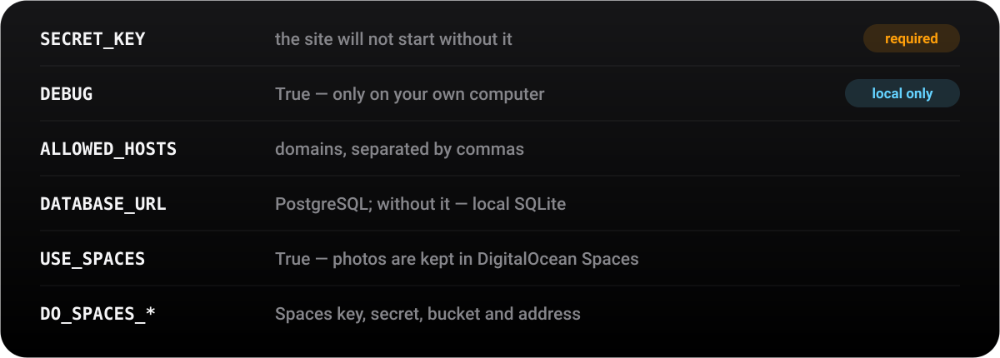

<!-- This file is built by a script: python3 scripts/build_readme.py. Edits by hand will be lost. -->
<p align="center"><b>English</b> &nbsp;|&nbsp; <a href="README.ru.md">Русский</a></p>

<a href="https://dr-isana.vercel.app"></a>

<p align="center">
  <a href="#site">Website&nbsp;›</a>&emsp;
  <a href="#features">Features&nbsp;›</a>&emsp;
  <a href="#stack">Under the hood&nbsp;›</a>&emsp;
  <a href="#structure">Structure&nbsp;›</a>&emsp;
  <a href="#run">Run&nbsp;›</a>&emsp;
  <a href="#deploy">Deploy&nbsp;›</a>
</p>

<br>



<br>
<br>

<p align="center">
  <i>«Simplicity is the ultimate sophistication.»</i><br>
  <sub>— the first Apple brochure, 1977</sub>
</p>

<br>

<a name="site"></a>


<a href="https://dr-isana.vercel.app"></a>

<br>
<br>

<a name="features"></a>


<a href="https://dr-isana.vercel.app/catalog/"></a>
<a href="https://dr-isana.vercel.app"></a>
<a href="https://dr-isana.vercel.app/reviews/"></a>
<a href="https://dr-isana.vercel.app/about/"></a>
<a href="store/admin.py"></a>

<br>
<br>

<a name="stack"></a>




<br>
<br>

<a name="structure"></a>




<br>
<br>

<a name="run"></a>




<details>
<summary>Copy the commands</summary>
<br>

```bash
# Install
python3 -m venv .venv && source .venv/bin/activate
pip install -r requirements.txt

# First run
echo "DEBUG=True" > .env
python manage.py migrate
python manage.py createsuperuser
python manage.py runserver

# Tests
python manage.py test

# Rebuild README
python3 scripts/build_readme.py
```

</details>

<br>
<br>

<a name="deploy"></a>




<br>



<br>


<p align="center">
  <sub>Dr. Isana · Bishkek &nbsp;·&nbsp; <a href="https://instagram.com/dr.isana">@dr.isana</a> &nbsp;·&nbsp; <a href="https://wa.me/996502259797">WhatsApp</a></sub><br>
  <sub>Made with ☕ and Django &nbsp;·&nbsp; <a href="https://github.com/a1tvv">@a1tvv</a></sub>
</p>
