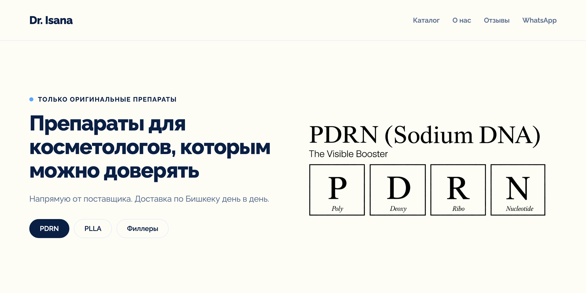
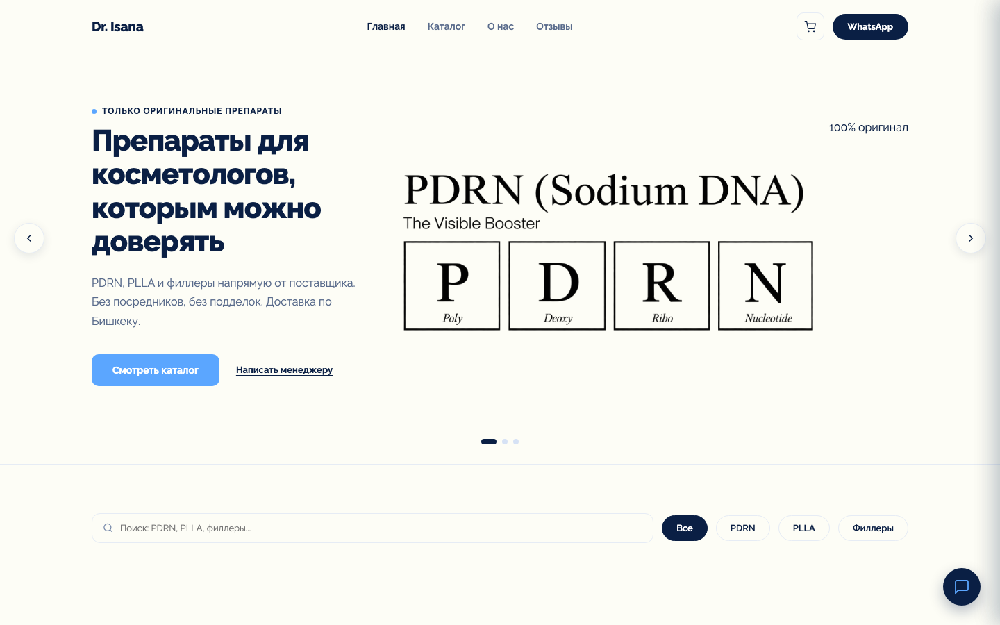
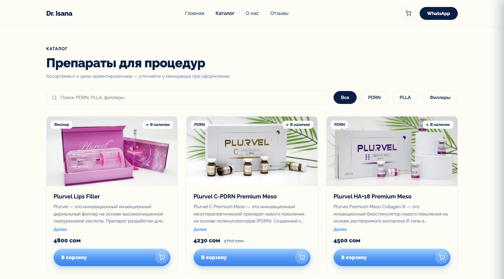

<p align="center">
  
</p>

<p align="center">
  <b>Dr. Isana</b> — магазин оригинальных препаратов для косметологов в Бишкеке.<br>
  PDRN, PLLA и филлеры напрямую от поставщика. Заказ уходит менеджеру в WhatsApp.
</p>

<p align="center">
  <a href="https://dr-isana.vercel.app"></a>
  
  
  
  
</p>

<br>

| Главная | Каталог |
| --- | --- |
|  |  |

## Что есть на сайте

- Каталог с фильтром по категориям (PDRN, PLLA, филлеры) и поиском
- Корзина без регистрации — хранится в браузере
- Оформление заказа: клиент оставляет имя и телефон, менеджеру в WhatsApp приходит готовый список товаров
- Страницы «О враче» и «Отзывы» с фото до/после
- Своя админка в стиле сайта: товары, отзывы, фото до/после

## Запуск локально

```bash
python -m venv .venv
source .venv/bin/activate
pip install -r requirements.txt

echo "DEBUG=True" > .env
python manage.py migrate
python manage.py createsuperuser
python manage.py runserver
```

Сайт откроется на http://127.0.0.1:8000. Тесты: `python manage.py test`.

## Переменные окружения

| Переменная | Зачем |
| --- | --- |
| `SECRET_KEY` | Обязательна на проде, без неё сайт не запустится |
| `DEBUG` | `True` только локально. На проде не задавать |
| `ALLOWED_HOSTS` | Домены через запятую, например `dr-isana.vercel.app` |
| `DATABASE_URL` | Подключение к PostgreSQL. Если не задана — локальная SQLite |
| `USE_SPACES` | `True`, чтобы фото товаров хранились в DigitalOcean Spaces |
| `DO_SPACES_KEY`, `DO_SPACES_SECRET`,<br>`DO_SPACES_BUCKET`, `DO_SPACES_ENDPOINT` | Доступ к Spaces |

Локально их можно положить в `.env` — он в `.gitignore` и в репозиторий не попадает.

## Деплой

Сайт на Vercel, обновляется сам после пуша в `main`.

Vercel не собирает статику, поэтому после правок в CSS, JS или картинках:

```bash
python manage.py collectstatic --noinput
```

и закоммитить `staticfiles/` вместе с остальным.

Если появилась новая миграция, её нужно применить к продовой базе:

```bash
DATABASE_URL="строка из настроек Vercel" python manage.py migrate
```

## Структура

```text
config/        настройки Django и адреса
store/         модели, вьюхи, админка, тесты
templates/     шаблоны сайта и админки
static/        исходные CSS, JS и картинки
staticfiles/   собранная статика для Vercel
docs/          картинки для README
```

<br>

<p align="center">
  <sub>Dr. Isana · Бишкек · <a href="https://instagram.com/dr.isana">@dr.isana</a> · <a href="https://wa.me/996502259797">WhatsApp</a></sub>
</p>
