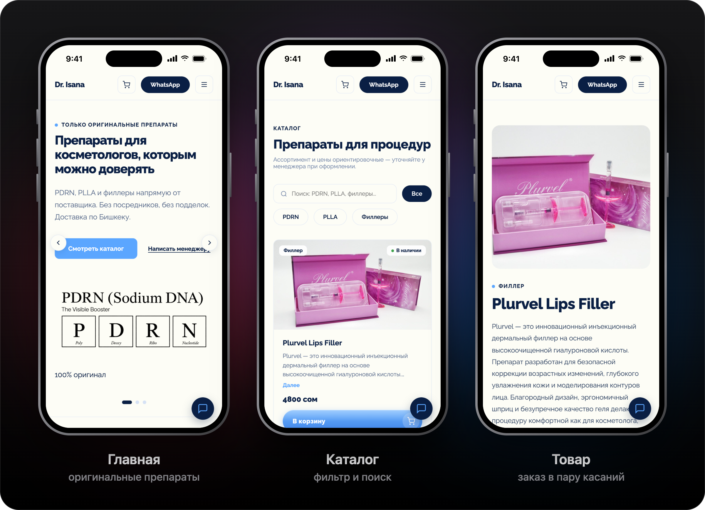
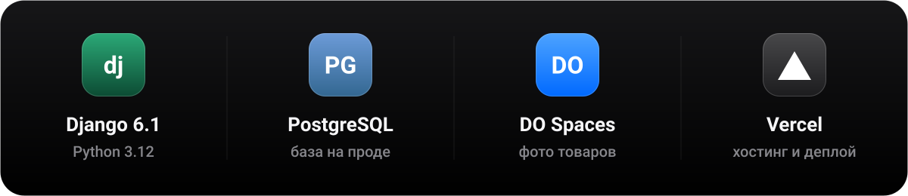
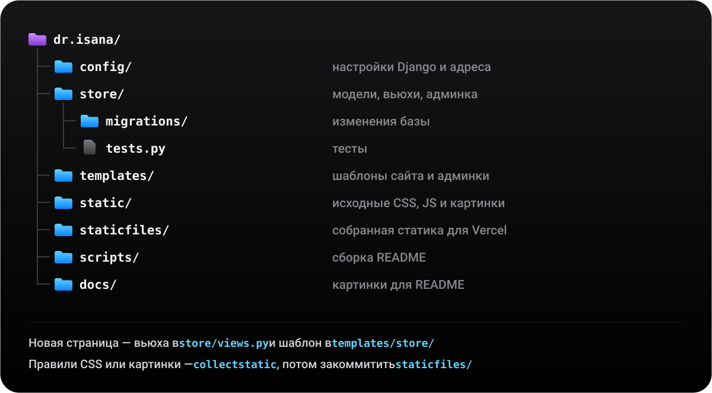
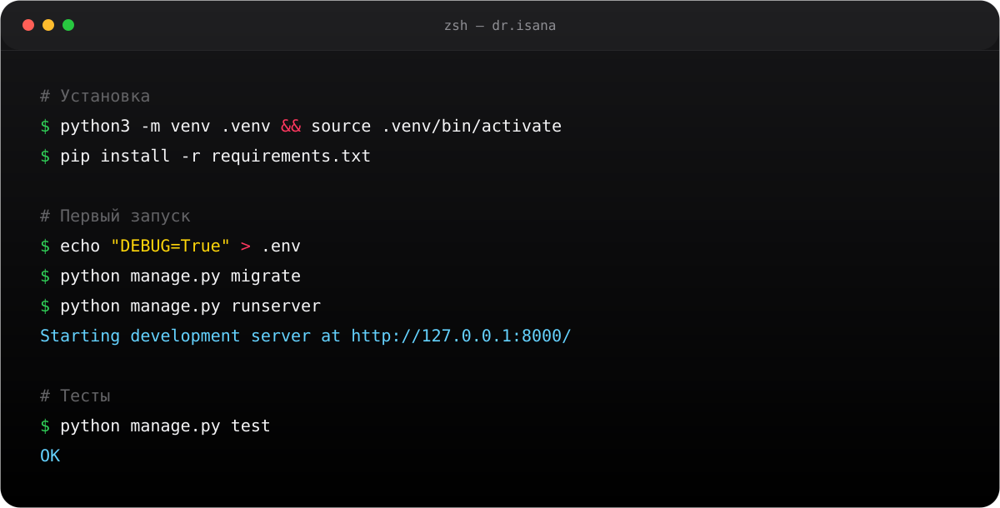
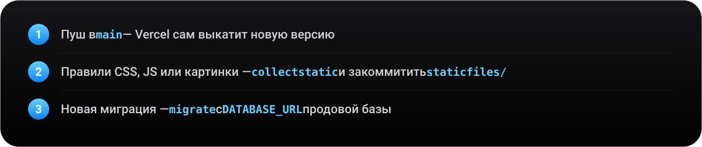
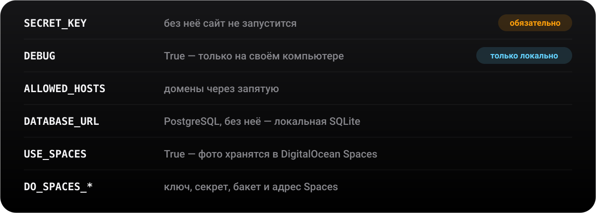

<!-- Этот файл собирается скриптом: python3 scripts/build_readme.py. Правки вручную перезапишутся. -->
<p align="center"><a href="README.md">English</a> &nbsp;|&nbsp; <b>Русский</b></p>

<a href="https://dr-isana.vercel.app"></a>

<p align="center">
  <a href="#site">Сайт&nbsp;›</a>&emsp;
  <a href="#features">Возможности&nbsp;›</a>&emsp;
  <a href="#stack">Под капотом&nbsp;›</a>&emsp;
  <a href="#structure">Структура&nbsp;›</a>&emsp;
  <a href="#run">Запуск&nbsp;›</a>&emsp;
  <a href="#deploy">Деплой&nbsp;›</a>
</p>

<br>



<br>
<br>

<p align="center">
  <i>«Simplicity is the ultimate sophistication.»</i><br>
  <sub>— первая брошюра Apple, 1977</sub>
</p>

<br>

<a name="site"></a>


<a href="https://dr-isana.vercel.app"></a>

<br>
<br>

<a name="features"></a>


<a href="https://dr-isana.vercel.app/catalog/"></a>
<a href="https://dr-isana.vercel.app"></a>
<a href="https://dr-isana.vercel.app/reviews/"></a>
<a href="https://dr-isana.vercel.app/about/"></a>
<a href="store/admin.py"></a>

<br>
<br>

<a name="stack"></a>




<br>
<br>

<a name="structure"></a>




<br>
<br>

<a name="run"></a>




<details>
<summary>Скопировать команды</summary>
<br>

```bash
# Установка
python3 -m venv .venv && source .venv/bin/activate
pip install -r requirements.txt

# Первый запуск
echo "DEBUG=True" > .env
python manage.py migrate
python manage.py createsuperuser
python manage.py runserver

# Тесты
python manage.py test

# Пересобрать README
python3 scripts/build_readme.py
```

</details>

<br>
<br>

<a name="deploy"></a>




<br>



<br>


<p align="center">
  <sub>Dr. Isana · Бишкек &nbsp;·&nbsp; <a href="https://instagram.com/dr.isana">@dr.isana</a> &nbsp;·&nbsp; <a href="https://wa.me/996502259797">WhatsApp</a></sub><br>
  <sub>Сделано с ☕ и Django &nbsp;·&nbsp; <a href="https://github.com/a1tvv">@a1tvv</a></sub>
</p>
